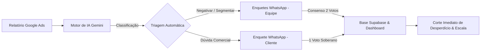

# 📱 POCKET GOOGLAR (Antygraviti OS)
## Documentação Estratégica, Conceitual e Executiva

---

### 📌 Resumo Executivo
O **Pocket** (também denominado no ecossistema como **Pocket Googlar** ou **Antygraviti OS**) é uma solução inteligente de **governança de mídia, auditoria semântica contínua e proteção de orçamento de anúncios** no Google Ads.

Diferente das ferramentas tradicionais de marketing que apenas geram relatórios passivos ou exigem centenas de horas humanas em planilhas estáticas, o Pocket combina **Inteligência Artificial de última geração (Google Gemini)**, **orquestração de automações (n8n)** e uma experiência de usuário **"zero atrito" via WhatsApp (Evolution API)** integrada a um **Dashboard de Gestão Executiva (React + Supabase)**.

O objetivo central do Pocket é simples e de alto impacto financeiro: **eliminar o desperdício de verba publicitária, identificar novas oportunidades de receita e colocar a tomada de decisão no bolso da equipe e do cliente, em tempo real.**

---

## 1. O Problema que o Pocket Resolve (A Dor de Mercado)

### 🔴 O Cenário Atual no Google Ads
1. **O "Vazamento Invisível" de Verba (GAP de Demanda vs. Oferta):**
   - No Google Ads (Rede de Pesquisa), algoritmos de correspondência ampla e inteligência do Google frequentemente exibem anúncios para buscas irrelevantes, curiosos, termos fora do catálogo ou concorrentes com intenções divergentes.
   - Em média, **20% a 45% do orçamento mensal de mídia** de uma empresa é consumido por termos que jamais converterão.
2. **Gargalo Operacional e Cansaço de Análise:**
   - Para encontrar esses vazamentos, analistas de tráfego precisam baixar relatórios com 5.000 a mais de 50.000 termos de pesquisa por mês e revisar linha por linha em planilhas gigantescas (Excel / Google Sheets).
   - O processo é lento, sujeito a erros humanos e muitas vezes negligenciado pela falta de tempo.
3. **Fricção na Comunicação com o Cliente Final:**
   - Quando surge uma dúvida técnica (ex: *"O cliente vende endoscópio veterinário flexível ou apenas rígido?"*), analistas mandam e-mails ou mensagens que se perdem. A campanha continua gastando dinheiro enquanto a dúvida não é respondida.
4. **Risco de Decisão Unilateral:**
   - Se um estagiário ou analista júnior negativar um termo por engano, ele pode "matar" uma palavra-chave que traria centenas de milhares de reais em vendas.

---

## 2. A Solução: O Que é o Pocket?

O Pocket transforma esse processo manual e arriscado em uma **esteira automatizada, colaborativa e à prova de falhas**:

### Os 4 Pilares do Pocket:
1. **Auditoria Semântica com IA Especializada:** Lê cada termo real pesquisado pelos usuários, compara com a proposta de valor do cliente e classifica a intenção de busca em segundos.
2. **Validação "In-Pocket" (WhatsApp Nativo):** Em vez de exigir login em ferramentas complexas, o sistema envia enquetes interativas nativas diretamente para o WhatsApp dos analistas e dos clientes.
3. **Mecanismo de Consenso Anti-Erro:** Decisões internas exigem confirmação dupla (consenso de 2 votos). Divergências geram alertas automáticos para debate da equipe.
4. **Governança e Visibilidade Executiva:** Um Dashboard moderno consolida o total em Reais (R$) economizados, termos auditados, precisão dos algoritmos e histórico de qualidade auditável.

---

## 3. Como o Pocket Funciona na Prática (O Fluxo de Ponta a Ponta)

### Passo 1: Ingestão de Dados de Pesquisa
- O sistema importa periodicamente (ou sob demanda via comandos) o relatório oficial de termos de pesquisa das campanhas do cliente.
- Suporta conexão direta via Google Sheets, arquivos Excel (.xlsx) e sincronização com banco de dados.

### Passo 2: Triagem Semântica Automatizada via IA
O motor cognitivo avalia cada termo cruzando com o "DNA Comercial" da empresa e com a palavra-chave que disparou a impressão, distribuindo o termo em 4 categorias estratégicas:
- ❌ **NEGATIVAR:** Termos irrelevantes, busca por vagas de emprego, assistência técnica não oferecida, produtos fora da grade ou intenções de baixa qualidade. (Corta o custo imediatamente).
- ✅ **SEGMENTAR:** Termos de altíssima intenção de compra que hoje estão "escondidos" dentro de grupos genéricos. Devem se tornar campanhas ou grupos específicos para baratear o custo por clique e aumentar as conversões.
- ⚠️ **TESTE A/B:** Termos promissores, mas que necessitam de acompanhamento de CTR e conversão antes de uma decisão definitiva.
- ❓ **DÚVIDA:** Termos ambíguos ou muito específicos da área de atuação do cliente, onde a IA reconhece que não tem certeza absoluta sobre o catálogo da empresa.

### Passo 3: O Sistema de Votação e Consenso da Equipe
Para os termos que demandam chancela humana:
- O Pocket cria automaticamente uma **enquete interativa no grupo de WhatsApp da equipe técnica**.
- **Regra de Consenso (2 Votos Obrigatórios):** Uma decisão só é dada como aprovada quando **dois membros da equipe** votam na mesma opção.
- **Detecção de Divergência:** Se o Analista A votar `❌ Negativar` e o Analista B votar `✅ Segmentar`, o bot envia uma mensagem na hora alertando a divergência com o nome dos votantes para que eles conversem e cheguem a um alinhamento técnico.

### Passo 4: O Canal Direto e Soberano com o Cliente
- Quando um termo é classificado como **Dúvida**, o Pocket despacha uma enquete diretamente para o grupo do WhatsApp daquele cliente específico (ex: Qualipix, Endomarcas, Magic Hands, Estremóz).
- A mensagem é contextualizada e traz apenas opções claras (ex: *"Vocês atendem este tipo de serviço?"*).
- **Decisão Soberana:** Como o cliente é o dono do negócio, o voto dele é único e soberano (1 voto encerra a decisão) e atualiza instantaneamente a base central.

### Passo 5: Painel Executivo e Consolidação (Dashboard Antygraviti)
Toda a inteligência gerada converge para o **Dashboard Web**, onde gestores e analistas têm acesso a:
- **Painel de ROI & Economia:** Gráficos com o valor em dinheiro poupado por conta das negativações realizadas.
- **Controle de Qualidade (QC1 e QC2):** Rastreabilidade total com registro de quem auditou e aprovou cada termo.
- **Copilot de Inteligência:** Chat multimodal alimentado por IA para auditar imagens de anúncios, landing pages e formular estratégias.
- **Central de Automações:** Monitoramento em tempo real do status das execuções, disparos manuais e logs.

---

## 4. Ferramentas e Tecnologias Utilizadas (O Ecossistema)

O Pocket foi construído sobre uma arquitetura moderna, modular e de alta disponibilidade:

| Ferramenta / Tecnologia | Função Estratégica no Projeto | Por que foi escolhida? |
| :--- | :--- | :--- |
| **n8n** | **Orquestrador Central de Workflows** | Plataforma líder de automação de processos. Gerencia o fluxo entre webhooks, inteligência artificial, regras de consenso, banco de dados e mensageria. |
| **Google Gemini (Google AI)** | **Motor de Inteligência Cognitiva** | Modelo de IA de alta velocidade e contexto amplo. Capaz de interpretar a nuance de intenção de milhares de buscas por minuto com custo de tokens extremamente baixo. |
| **Evolution API** | **Conexão com WhatsApp** | API corporativa de integração com WhatsApp. Permite o envio de enquetes interativas nativas, leitura de votos via webhooks e comandos de terminal via chat (ex: `/ups cliente`). |
| **Supabase (PostgreSQL)** | **Banco de Dados em Nuvem e Segurança** | Fornece persistência em tempo real e segurança de nível bancário com **Row Level Security (RLS)**, garantindo isolamento total entre empresas (multitenancy). |
| **Dashboard (React 19 + Vite)** | **Interface Visual e Cockpit do Usuário** | Interface frontend de alto padrão estético (Antygraviti OS), ultrarrápida, com visualizações de dados, gráficos analíticos e controle operacional. |
| **Tailwind CSS & Ant Design** | **Design System & Componentes** | Proporciona uma experiência visual premium, responsiva, fluida e com suporte a temas modernos e dados densos (tabelas de auditoria). |
| **Coolify / VPS / Hostinger** | **Infraestrutura e Deploy Contínuo** | Gerenciamento autônomo dos servidores, garantindo que o sistema rode 24 horas por dia, 7 dias por semana, com segurança e estabilidade. |

---

## 5. Diferenciais Competitivos (Por que o Pocket é Único?)

1. **Adoção Próxima de 100% pelo Cliente:**
   - Clientes odeiam abrir softwares novos, lembrar senhas ou analisar planilhas de 20 colunas. O Pocket leva a pergunta pronta para onde o cliente já passa o dia todo: **o WhatsApp**.
2. **Eliminação do Erro Individual (Consenso 2x):**
   - Nenhuma decisão crítica depende do humor ou cansaço de uma única pessoa. O sistema obriga a validação em par na equipe técnica.
3. **Agilidade Extrema:**
   - Uma auditoria que antes demorava 2 a 3 semanas para ser concluída é resolvida em poucos minutos ou ao longo do dia com toques rápidos na tela do celular.
4. **Isolamento e Segurança Corporativa (Multitenant):**
   - A mesma infraestrutura atende diversos clientes com total blindagem de dados — nenhum cliente tem acesso aos dados, termos ou métricas de outro.
5. **Cálculo Tangível de ROI:**
   - O sistema mostra em números reais para o investidor e para o cliente: *"Este mês, o Pocket evitou que R$ 14.850 fossem jogados no lixo no Google Ads"*.

---

## 6. Visão para Investidores e Analistas de Negócio

### 📈 Oportunidade de Mercado e Escalabilidade
- **SaaS de Mídia Inteligente:** O Pocket tem potencial para operar tanto como motor interno de alta margem para agências de performance quanto como um produto SaaS (Software as a Service) comercializado por assinatura para empresas que gerenciam seu próprio tráfego.
- **Redução Drástica do Custo Operacional:** Uma agência tradicional precisa de 1 analista dedicado para cada 5 ou 8 contas médias. Com o Pocket, a mesma equipe é capaz de gerenciar com qualidade superior 30 a 50 contas, aumentando exponencialmente a margem de lucro.
- **Retenção de Clientes (LTV Alto / Churn Baixo):** Quando o cliente final vê a agência interagindo semanalmente via enquetes com dúvidas pontuais e mostrando a economia gerada, a percepção de valor do serviço sobe expressivamente, reduzindo cancelamentos a quase zero.

---

## 7. Glossário de Termos do Projeto

- **Termo de Pesquisa:** Exatamente o que o internauta digitou no buscador do Google.
- **Palavra-chave:** O termo contratado pela empresa na conta de anúncios para acionar o anúncio.
- **Negativação:** Configuração que impede que o anúncio apareça para determinados termos no futuro, estancando o desperdício financeiro.
- **Segmentação (STAG / SKAG):** Criação de grupos de anúncios altamente específicos para termos de grande valor, aumentando a relevância do anúncio e barateando o leilão.
- **QC (Quality Control):** Camadas de validação interna (QC1 para primeiro analista, QC2 para revisor sênior).
- **Evolution API:** Interface técnica que viabiliza o envio de enquetes e mensagens no WhatsApp.
- **Multitenancy:** Arquitetura de software onde uma única plataforma atende múltiplos clientes mantendo seus dados rigorosamente separados.

---

*Documento Estratégico do Ecossistema Pocket Googlar / Antygraviti OS.*
*Versão Executiva 2.0*
